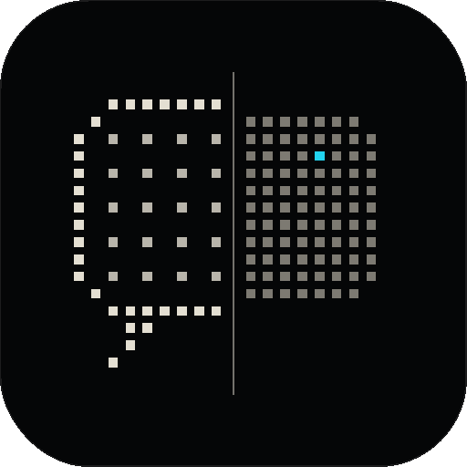

# Unbubble

*Get your messages out of their bubbles.*

**Free, open-source iPhone message exporter for Windows.** Plug in an iPhone and export every iMessage and text conversation, with photos, reactions, replies and edits, without making a full backup.

It powers the upload flow on [thegreymirror.com](https://thegreymirror.com), and it works on its own as a standalone Windows app.

## Where it fits on thegreymirror.com

Grey Mirror's upload wizard asks where someone's messages live. People with only an iPhone and a Windows PC are sent here: they install Unbubble, plug in the iPhone, and pick the conversation to upload, all without leaving the site. Mac users get the Grey Mirror Mac app instead, which reads Messages on the Mac directly. The wizard itself lives in the site; this repository is the exporter it drives.

## What Unbubble does (Windows)

1. **Sets up Apple's iPhone driver in one click.** Windows can only reach an iPhone through Apple Mobile Device Service. The app installs Apple's official standalone package (`Apple.AppleMobileDeviceSupport`, via winget) after a single Windows permission prompt. There's no iTunes and no detour to another site.
2. **Streams only your messages off the iPhone.** iOS releases the Messages database only through its backup service, so the app drives that service itself and keeps only Messages and Contacts as the bytes arrive. Photos, apps and everything else are drained and discarded on the fly, so there's no backup folder and no need for 100+ GB free.
3. **Makes every export after the first fast.** It keeps the phone's small file index, so the next run is incremental: the iPhone sends only what changed.
4. **Rebuilds every conversation faithfully**, including:
   - SMS and iMessage threads with the same person, merged into one conversation
   - group names and member changes
   - tapbacks and emoji reactions, with removals replayed
   - inline replies, full edit history, unsent messages and message effects
   - text Apple stores only in `attributedBody`
   - HEIC photos converted for every browser
   - attachments offloaded to iCloud, clearly flagged
5. **Saves to your PC** as a browsable offline HTML archive, one PDF per conversation, CSV, or JSON. It defaults to your real Documents folder and warns before saving into OneDrive, which would upload your messages to the cloud.
6. **Uploads to Grey Mirror only when you choose to,** one conversation at a time.
7. **Turns a screen recording into a conversation.** No cable needed: screen-record a thread in Messages while you scroll back through it, and Unbubble reads every message, who sent it and the time header it sits under. Drop the video on the page, pick it on your PC, or plug in the iPhone and pick it straight from its camera roll. Messages appear on screen as they're read, and anything unclear (emoji, a sticker, a hard-to-read bubble) comes back for a quick look, shown as it appeared in the video. It's read entirely on your PC with on-device OCR and saved like any other export, so CSV, PDF, HTML, JSON and the upload all work.

No accounts, no analytics, no telemetry.

## How the website reaches the app

```
thegreymirror.com (browser)
   │  Chrome, Edge, Firefox, Brave:  ws://127.0.0.1:47613  (origin-locked to thegreymirror.com)
   │  Safari:  wss://relay.thegreymirror.com  (end-to-end encrypted; the relay sees only ciphertext)
   ▼
Unbubble (notification-area app on the PC)  ──USB──►  iPhone
```

- **Direct.** The app listens only on loopback and accepts WebSocket connections whose `Origin` is thegreymirror.com (or its own UI). It rejects mismatched `Host` headers, which blocks DNS rebinding.
- **Relay, for Safari on Windows.** The page's ECDH P-256 public key reaches the app through the `unbubble://` link handler, never through the relay. Keys come from HKDF-SHA256 with one AES-256-GCM key per direction, and counter nonces reject replays. The first pairing from a browser needs a native **Allow** prompt with a matching code.

## Repository layout

| Folder | What | License |
| --- | --- | --- |
| `helper/` | Unbubble: iPhone capture, driver setup, rebuild, exporters, local server, relay client, tray app, Windows installer | GPL-3.0-or-later |
| `web/` | The export interface (standalone or embedded in a site) and the `ConnectClient` SDK (React 19, Vite 8, TypeScript 7) | MIT |
| `relay/` | The Safari relay (Cloudflare Worker + Durable Objects) and a Node twin for local development | MIT |
| `tests/` | Cross-language end-to-end test of the encrypted relay | MIT |

The app is GPL because it builds on [pymobiledevice3](https://github.com/doronz88/pymobiledevice3) (GPL-3.0) and [pyiosbackup](https://github.com/doronz88/pyiosbackup). The web and relay code talk to it over a network protocol and are MIT, so any site can embed the flow.

## Install

Download **Unbubble-Setup.exe** from the [latest release](https://github.com/justlayme/unbubble/releases/latest). It needs Windows 10 (1809) or 11 and installs per-user, without admin rights; only Apple's driver asks for permission.

## Develop

```bash
# App (Python 3.11+)
cd helper && pip install -e ".[dev]" && pytest -q
python tests/make_fixture.py /tmp/fixture 20000      # a realistic sms.db with every edge case

# Run against a mock iPhone, including the Windows driver flow (no hardware needed)
GM_DEV=1 GM_MOCK_DEVICE=1 GM_MOCK_FIXTURE=/tmp/fixture GM_MOCK_PLATFORM=windows GM_MOCK_DRIVER_MISSING=1 \
  python -m unbubble serve

# Web, in another terminal
cd web && npm install && npm test && npm run dev     # http://127.0.0.1:5173/export/
```

Useful app commands:

- `unbubble import-db <sms.db>` imports a Messages database directly.
- `unbubble import-recording <video.mp4|.mov> [--recorded-at 2026-10-16T21:30]` reads a screen recording.
- `unbubble export <archive-id> --formats html,pdf,json,csv` runs an export from the command line.

## Embed on thegreymirror.com

Build `web/` (`npm run build`) and serve `dist/` at `/export/`, or mount it into an existing page:

```tsx
import { UnbubbleApp } from "unbubble-web";

<UnbubbleApp
  uploadLabel="Upload to Grey Mirror"
  // Called with one conversation when the person chooses to upload it.
  onUpload={async ({ thread, messages, source }) => {
    await fetch("/api/upload", { method: "POST", body: JSON.stringify({ thread, messages, source }) });
  }}
  onBack={() => history.back()}
/>
```

Sites that want their own interface can use `ConnectClient` directly and call the app's RPC methods (`devices.list`, `capture.start`, `recording.start`, `archive.threads`, `archive.thread_dump`, …).

Configure with `VITE_GM_RELAY_URL`, `VITE_GM_SITE_URL`, `VITE_GM_SOURCE_URL` and `VITE_GM_DOWNLOAD_WIN`.

## Release

Push a tag like `v1.0.0`. `.github/workflows/release.yml` runs the tests on Windows, builds the app and the installer, and attaches `Unbubble-Setup.exe` to a GitHub Release, which is what the website's download button points at.

Sign the installer to avoid SmartScreen warnings. Open-source projects can get free code signing from the [SignPath Foundation](https://signpath.org); Azure Trusted Signing also works.

## Limits worth knowing

- The **first** export takes about as long as an iPhone backup, because iOS sends everything once and the app discards what isn't Messages. Later exports are incremental. A USB 3 cable with a USB‑C iPhone is much faster.
- If the iPhone has **"Encrypt local backup"** on, the person enters that password once. It never leaves their PC.
- Attachments iOS **offloaded to iCloud** aren't on the phone, so they're listed but can't be exported.
- **Screen recordings** show only what was on screen. iOS doesn't let apps scroll Messages, so the person scrolls while recording, slowly enough that each bubble is on screen for a moment. Times come from Messages' own headers, so messages under one header share its time, and anything above the first header in the recording is undated. Photos and emoji are kept as markers like `[Photo]` and `[Emoji]` (the review screen lets you type an emoji in), link previews keep their title and site; tapbacks aren't captured. Reading takes about a second per screenful of messages, faster on machines with more cores.

### How screen recordings are read

`helper/unbubble/recording.py`. Every recording is read at one working size, whatever the iPhone.

- **Following the scroll.** Each frame is matched against the last over almost the whole screen (a flick can move most of a screen in one frame), on its most textured strip, so every frame gets a place in one long "thread" coordinate. Rows that never move are the status bar, header, text field and keyboard.
- **Skipping what isn't the thread.** Control Center at the start and end of every recording, the app switcher and notification banners are recognised by the header and text field looking unlike the rest of the recording.
- **Choosing frames.** People flick, then pause: frames are taken from the pauses (sharp, cleanly compressed), and only a stretch never seen still is read from a moving frame.
- **Reading.** Messages are found by which edge they hug (yours on the right, theirs on the left) and by colour: flat blue, green or grey bubbles; photos and big emoji as large non-background shapes; link previews as an image over a grey caption. Tapback badges, avatars and the typing indicator are left out. Text is OCR'd on device (RapidOCR, ONNX), on several cores at once, with run-together words and lone letters repaired. Centred grey lines are time headers ("Today 9:41 AM", "Saturday 1:30 AM", "Sat, Oct 11 at 3:20 PM"); small names above grey bubbles are group senders.
- **Stitching.** Each strip is placed by the scroll estimate, then pinned by the text it shares with what's already read (votes weighted by how unique each message is). A bubble seen in ten frames is kept once; two identical messages sent at different times are both kept; anything only ever seen cut off gets a second look from the frame with the most room for it.

`python tests/recording_fixture.py OUT [--rich] [--keyboard]` and `node tests/record_fixture.mjs OUT [--dpr 3] [--cc] [--banner]` render and scroll a Messages look-alike at iPhone resolution with exact ground truth: photos, link previews, tapbacks, the typing indicator, the keyboard, Control Center and banners included. `python tests/eval_recording.py OUT` scores the reader against it. On seven such recordings (light, dark, one-to-one and group, H.264 and HEVC, 2.25x and 3x, keyboard open, heavy compression) it reads 448 of 450 messages word for word, with the right sender and time.

See [SECURITY.md](SECURITY.md) to report a vulnerability privately.
